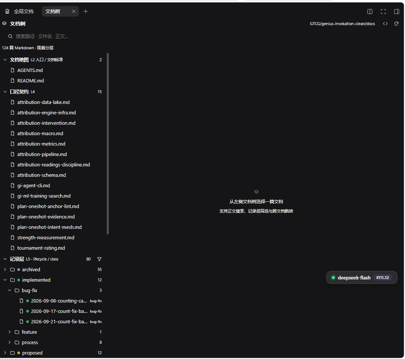
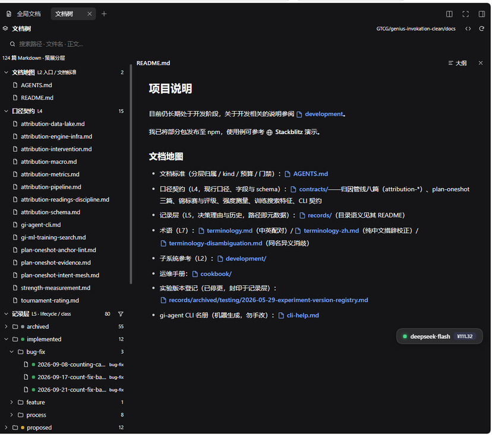
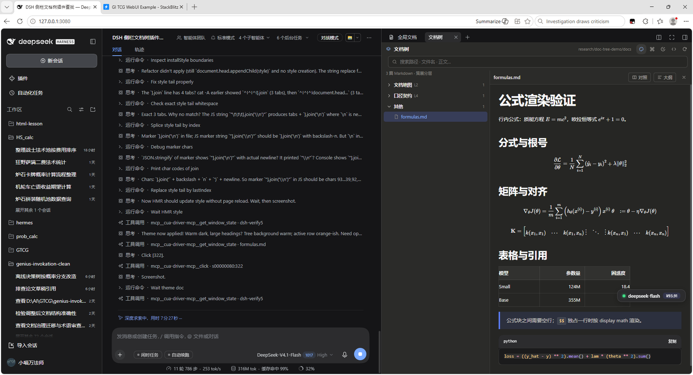
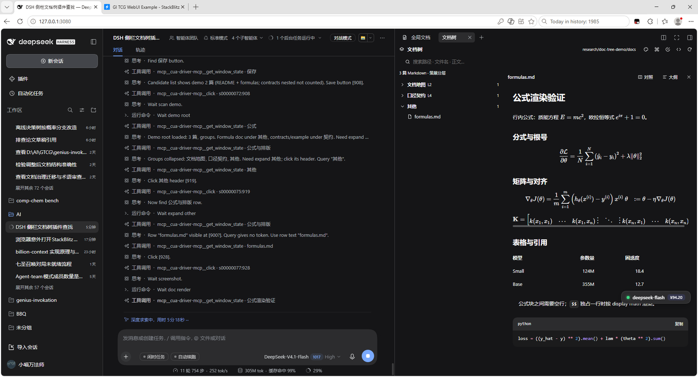
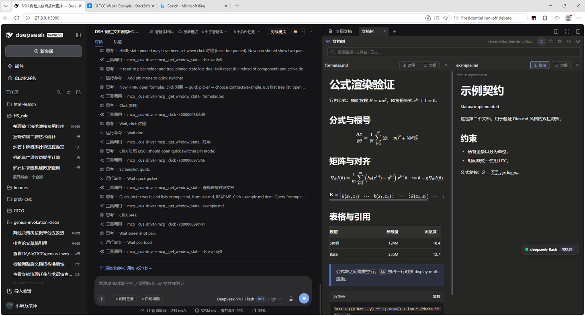
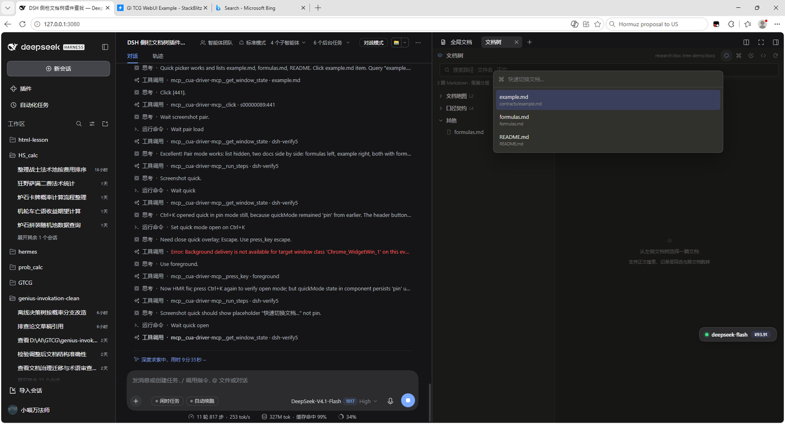
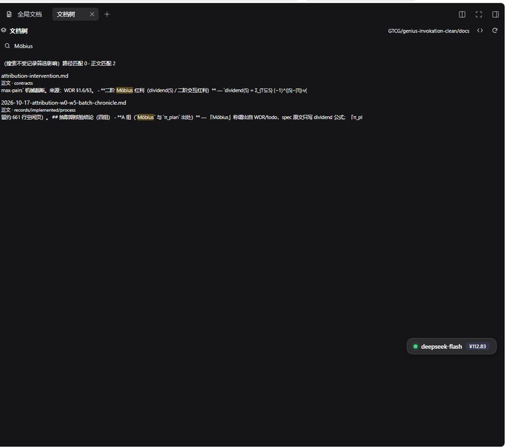
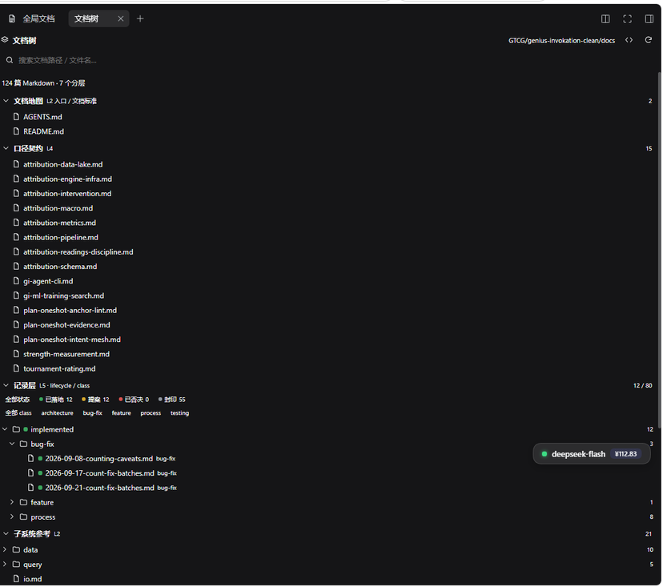

# dsh-doc-tree

**A governed documentation tree for the DeepSeek Harness right sidebar.**

在 DSH 原生右侧栏里按分层浏览文档、展开 `records/{lifecycle}/{class}`、全文搜索、同栏阅读 Markdown，并通过 `/docs-organize` 让模型完成语义分层、机械体检与人工审批。

还带一个 **Files.md 风格** 的阅读模式：暖色主题、双文档对照、`Ctrl/Cmd+K` 快速切换，以及行内/块级 LaTeX 公式渲染。













## 特性

- **策展分层**：文档地图 / 口径契约 / 记录层 / 子系统参考 / 运维手册 / 术语 / 其他；组头显示篇数，可折叠。
- **记录层语义**：`records/{proposed|implemented|rejected|archived}/{class}` 自动成树；生命周期色点 + class 标签；阅读时把首部 `Status:` 行提到标题下；记录层内可按 lifecycle / class 筛选。
- **根目录扫描**：雷达按钮扫描工作区（`docs`/`documentation`/`wiki`，以及项目目录下的 `docs`），候选带篇数，点选切换。
- **搜索**：路径/文件名 + 正文全文（后台建立内存索引，命中带上下文片段与高亮）。
- **阅读**：复用宿主 `MarkdownText`，相对 `.md` 链接在 tab 内跳转，`大纲` 按 h1–h4 导航。
- **配置驱动**：工作区根 `.dsh-doc-tree.json` 定义 `root` / `groups` / `records.statuses`；没有配置时用内置默认分层。
- **AI 分层**：`/docs-organize` 让模型 scan → 读入口 → lint → dry-run → 用 `ask_user_question` 批量审批 → 写配置。
- **布局**：右栏 ≥700px 自动双栏（列表 + 阅读区），更窄时单栏下钻；排版对齐 DSH 文档预览的阅读体验。
- **Files.md 风格**：顶栏调色板按钮切换暖色主题（大标题、暖灰背景、蓝链接、左侧蓝条引用）。
- **双文档对照**：阅读器「对照」按钮选择第二篇文档；宽屏显示「列表 + 两篇」，窄屏自动隐藏列表、两篇平分。
- **快速切换**：`Ctrl/Cmd+K` 打开命令面板，按路径过滤，↑/↓ 选择，Enter 打开。
- **LaTeX 公式**：`$...$` 行内、`$$...$$` 块级；矩阵、分式、对齐、表格混排；复用宿主 KaTeX，不额外打包。





## 独立性

本插件**不依赖** `dsh-docs-panel` 或 `dsh-better-sidebar`。它只使用 DSH 官方扩展点：

- 右侧栏 tab：`ctx.sidebarRightTabs.register` + `sidebar.right.pane.tab` slot
- 数据：`workspaceFiles` Remote（只读）
- Markdown：baseline `@deepseek-ai/dsh-client-ui-primitives` 的 `MarkdownText` / `MarkdownDelegateProvider`
- Host 工具：`ctx.tools.register` + `ctx.commands.register` + `ctx.fs`

## 键盘与交互

| 操作 | 快捷键 / 入口 |
|---|---|
| 快速切换文档 | `Ctrl/Cmd+K` |
| 关闭快速切换 / 大纲 | `Esc` |
| 切换 Files.md 风格 | 顶栏调色板按钮 |
| 双文档对照 | 阅读器「对照」→ 选择第二篇 |
| 取消对照 | 右侧阅读器「取消」 |
| 切换原始结构 | 顶栏 `<>` |
| 重新扫描 | 顶栏 `⟳` |
| 扫描文档根 | 顶栏雷达按钮 |

## 公式

公式由宿主 `MarkdownText` 的 KaTeX 渲染，插件不引入额外依赖：

```markdown
行内：$E = mc^2$

$$
\frac{\partial \mathcal{L}}{\partial \theta}
= \frac{1}{N}\sum_{i=1}^{N}(\hat{y}_i - y_i)^2
$$
```

块级公式建议 `$$` 独占一行，前后留空行。示例见 [examples/docs/formulas.md](examples/docs/formulas.md)；把根指向 `examples/docs` 即可在插件里看到公式、矩阵、表格与对照效果。

## 安装

要求 DSH `0.2.1-rc.1+`（开发验证于 `0.2.1-rc.2`）。

```bash
# 从 GitHub 安装（dsh plugin 会把参数转发给 pnpm）
dsh plugin --profile web add github:Meowrium/dsh-doc-tree

# 或本地开发
git clone https://github.com/Meowrium/dsh-doc-tree
dsh plugin --profile web add /path/to/dsh-doc-tree
```

安装后重启 `dsh web`，浏览器硬刷新（Ctrl/Cmd+Shift+R）。右侧栏「＋」→「文档树」。

开发期可用 `dsh-super-injector` 热装配，免重启：

```text
dev_install_package /path/to/dsh-doc-tree
```

## 快速开始

1. 打开右侧栏「＋」→「文档树」。
2. 首次打开会自动扫描候选根目录；也可点顶部雷达按钮重扫，点候选路径后「保存」。
3. 点右上角 `<>` 可在「策展分层」和「原始目录结构」之间切换；`⟳` 重新扫描。
4. 点击文档在右侧阅读；`大纲` 打开标题导航，`×` 关闭当前文档。
5. 想看公式/对照示例：把根目录填成 `<workspace>/dsh-doc-tree/examples/docs`。

## 配置

配置写在**工作区根** `.dsh-doc-tree.json`（不是文档目录内）：

```json
{
  "version": 1,
  "root": "docs",
  "generatedAt": "2026-10-19T00:00:00.000Z",
  "generatedBy": "docs-organize",
  "groups": [
    { "id": "map", "title": "文档地图", "hint": "L2", "match": ["README.md", "AGENTS.md"] },
    { "id": "contracts", "title": "口径契约", "hint": "L4", "prefix": "contracts/", "match": ["contracts/**"] },
    { "id": "records", "title": "记录层", "hint": "L5", "prefix": "records/", "match": ["records/**"], "records": true },
    { "id": "development", "title": "子系统参考", "hint": "L2", "prefix": "development/", "match": ["development/**"] },
    { "id": "other", "title": "其他", "match": ["**"] }
  ],
  "records": {
    "dir": "records",
    "lifecycles": ["proposed", "implemented", "rejected", "archived"],
    "statuses": { "records/implemented/feature/x.md": "implemented" }
  }
}
```

- `match`：相对文档根的 glob，`*` 段内、`**` 跨段、`?` 单字符；按数组顺序匹配，建议最后一组放 catch-all。
- `prefix`：仅用于显示时剥离路径前缀。
- `records: true`：该组启用 lifecycle 色点与筛选。
- `records.statuses`：`includeStatus:true` 时生成的快照，读取正文时仍以文件为准。
- 根目录也支持工作区相对路径，如 `project/docs`。

## AI 分层：`/docs-organize`

```text
/docs-organize                 # 默认：scan + lint + dry-run + 人工审批
/docs-organize docs            # 指定工作区相对根
/docs-organize --report docs   # 只出报告：不提问、不写配置
```

默认流程：

1. `doc_tree_scan` 拿文件清单与候选根。
2. 阅读 `README.md` / `AGENTS.md` / 索引，判断分层语义（明确要求「不要按目录名硬套」）。
3. `doc_tree_lint` 做机械体检，把问题分成「必须人决定」和「仅报告」。
4. 设计 3–8 个分组 + 待决策清单（合并/归档/改名/状态冲突/断链），**先不写**。
5. `doc_tree_apply_plan(dryRun:true)` 拿覆盖校验与「旧配置 → 新配置」diff。
6. **必须调用 `ask_user_question`**（不是正文提问）批量审批，最多 3 问、固定 id：
   - `apply-plan`：应用 / 只看报告 / 调整后重试
   - `lint-decisions`：仅报告 / 允许处理可机械项 / 逐项说明
   - `status-snapshot`：写入 / 不写
7. 选「应用」才 `dryRun:false` 落盘；选「只看报告」输出清单；选「调整」改完重跑 dryRun（≤2 轮）。
8. `ask_user_question` 不可用/报错时**禁止写配置**，输出结构化「待审批清单」。

**边界**：合并/删除/移动文档不在本命令范围内；lint 问题默认只报告，除非用户明确同意处理「可机械项」。

### 工具

| 工具 | 作用 |
|---|---|
| `doc_tree_scan {root?, includeStatus?}` | 扫描 Markdown、返回候选根与文件清单（标题 / Status / 字节） |
| `doc_tree_lint {root?, includeLinks?, maxIssues?}` | 只读体检：重复内容/标题、断链、孤儿、入口可达性、Status 冲突、未归类、空文档 |
| `doc_tree_read_plan {}` | 读当前 `.dsh-doc-tree.json`（没有返回 `null`） |
| `doc_tree_apply_plan {root, groups, records?, includeStatus?, dryRun?}` | 校验覆盖；`dryRun:true` 只返回 diff 不写，false/省略才写配置 |

### 人工审批

- **过程内（默认）**：模型在写配置前必须调用 DSH 自带的 `ask_user_question`，一次批量问 1–3 个问题，拿到答案后才执行；问题渲染成交互卡片。
- **结束统一审批**：`--report` 或用户选「只看报告」时不写配置，只输出分组表、diff、lint issues、建议动作与未决问题；人工确认后再跑一次普通 `/docs-organize`。

必须人工确认：覆盖已有配置、处理 lint 的重复/断链/孤儿/状态冲突、写入 `records.statuses`、任何文档内容改动（本命令不做）。

## 结构

```
dsh-doc-tree/
├─ package.json       # dsh.bundle.patch + dsh.client(platform:web)
├─ cordis.patch.yml   # bundle 挂载行
├─ lib/index.js       # host：doc_tree_* 工具 + /docs-organize 命令
├─ lib/client.js      # client：tab 类型注册 + 扫描/配置 + 树 + 阅读器
├─ examples/docs/     # 公式 / 对照示例文档
└─ docs/screenshots/  # README 截图
```

## 扩展点

- 类型：`ctx.sidebarRightTabs.register({ id, kind, priority:'extension', keepMounted, title, guide })`
- 正文：`ctx.slots.register({ name:'sidebar.right.pane.tab', key:id, inject:(sessionId)=>({...}) }, Body)`
- 数据：`ctx.remote.workspaceFiles.list(sessionId, workspaceRel, signal)` 与 `read(sessionId, absolutePath, { offset, limit }, signal)`
- Markdown：`MarkdownText` + `MarkdownDelegateProvider`（baseline 模块，无需 `dsh.client.external`）

## 已知限制

- 自动扫描是有界启发式（约 64 个一级目录 × 16 个子目录），超大仓库建议直接 `/docs-organize <root>` 或手填 root。
- 没有配置且内置分组一个都匹配不上时，所有文件落到「其他」；此时可用「原始结构」或生成配置。
- `groups` 只做 glob 机械匹配；语义分层由模型在 `/docs-organize` 中判断。
- 正文索引在打开 tab 后后台建立，不做增量更新；外部改动后点 `⟳` 重建。
- 单文件读取上限 5000 行（`workspaceFiles.read` 分页参数）。
- 记录状态徽标取自路径 lifecycle；文件内 `Status:` 在阅读时显示。
- 未做虚拟滚动；上千篇文档建议加。
- 窄屏对照模式会隐藏左侧文档列表，点右侧「取消」回到列表。
- 公式渲染依赖宿主 `MarkdownText` 的 KaTeX（DSH 0.2.1-rc.2 已内置）；未加载 KaTeX 时公式会退化为文本。
- Files.md 风格是视觉/交互移植，不包含它的编辑器、chat、sync 或文件写入能力。

## 开发与验证

```bash
node --check lib/client.js
node --check lib/index.js
```

已验证：DSH `0.2.1-rc.2` 右侧栏注册、124 篇扫描、记录层 80 篇展开、跨文档链接、全文搜索、记录筛选、dry-run diff、lint（真实文档 124 篇 / 0 error）、行内/块级 LaTeX、矩阵、双文档对照、`Ctrl/Cmd+K`。

## 致谢

- UI 布局与阅读排版参考了 [mlosun/dsh-docs-panel](https://github.com/mlosun/dsh-docs-panel)（MIT）。
- Files.md 风格参考了 [zakirullin/files.md](https://github.com/zakirullin/files.md)（MIT）；本插件只移植视觉/交互，未引入其代码。
- 右侧栏扩展点与 Markdown 渲染来自 [deepseek-ai/deepseek-harness](https://github.com/deepseek-ai/deepseek-harness) 的公开包。

## License

MIT
